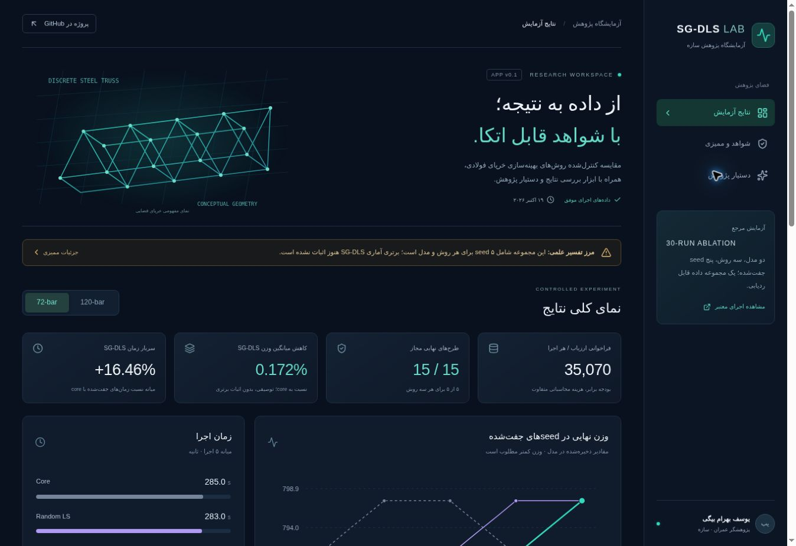

# SG-DLS Research Lab

[Open the published app](https://sgdls-research-lab.yousefbhb.chatgpt.site) (owner-private access)

## GitHub source copy

This folder contains the published application source snapshot (Site source commit 2bad8ebf9f00df527b7400ef0084aed283b720dc). The hosted Site maintains its own source repository; uploading this copy does not configure automatic GitHub deployment.

For local development, enter `apps/sgdls-research-lab`, install the locked dependencies with `pnpm install --frozen-lockfile`, then run `pnpm dev`. Node.js >=22.13.0 is required. This is a server-backed Vinext/Cloudflare application, not a GitHub Pages static site.

Hosted build and UI checks passed. OpenAI integration is implemented but inactive and has not been live-tested. Configure a server-side runtime secret through the authorized OpenAI Developers flow to activate it.

Author: Yousef Bahram Beigi (یوسف بهرام بیگی)

Persian RTL research application built from the authoritative run 39207965973 of y0bahrambeigi/bhb. This app is separate from publication of the research algorithm itself.

## Features

- Both 72-bar and 120-bar, all 30 method/seed rows
- Paired-seed final weights, runtime medians, paired overhead, raw diagnostics
- Method filters, original and filtered CSV exports, original JSON summary, print report
- Provenance, checksums and explicit scientific caveats
- Server-only OpenAI Responses API integration; requires authenticated user and runtime secret

## OpenAI setup

Use the OpenAI Developers plugin's openai-platform-api-key flow to authorize API key creation/configuration. Do not paste a key in chat, browser code, repository or hosting manifest. Configure OPENAI_API_KEY as a hosted runtime secret. OPENAI_MODEL defaults to gpt-5.4-mini and can be overridden by the owner. Confirm model access and billing before live verification. The assistant is disabled until a key exists. No live OpenAI call has yet been tested.

Model documentation: https://developers.openai.com/api/docs/models/gpt-5.4-mini
Responses API: https://developers.openai.com/api/reference/resources/responses/methods/create

## Data provenance

Source commit: a8d9fc46966842ec56980853a4ee4ab56395a7e0
Artifact: 12168833062, sgdls-full-30run-35070-p4
CSV SHA256: 2e13eba58e4ccbfb9f3e8b28fd359bba337edd01717d6264ffc49f5b37fc590e
Data are a fixed snapshot dated 2026-10-19, not a live GitHub feed. Issues/PR status links point to current external records. No user secrets or API keys are included.

There are five paired seeds per method/benchmark, not thirty independent repetitions. All first-feasible FE values equal 1 due to feasible midpoint initialization. Statistical superiority is not established. No convergence histories or new structural solver executions are provided. Repeated mode derivative accuracy and the 72-bar/2030 acceptance anomaly remain open research questions.

## Validation

Run node node_modules/typescript/bin/tsc --noEmit and the Sites build helper. Browser QA covers benchmark switching, filtering and assistant setup state. The 390px iframe viewport checks responsive layout, not an actual phone. Numerical integrity can be checked with scripts/verify-research.mjs.

## Deployment

This project uses the Sites-managed Git source repository. The app is deployed with the assistant disabled. Configure the OpenAI runtime secret and verify a live response before enabling the assistant. Preserve owner-private access unless the owner requests otherwise.
